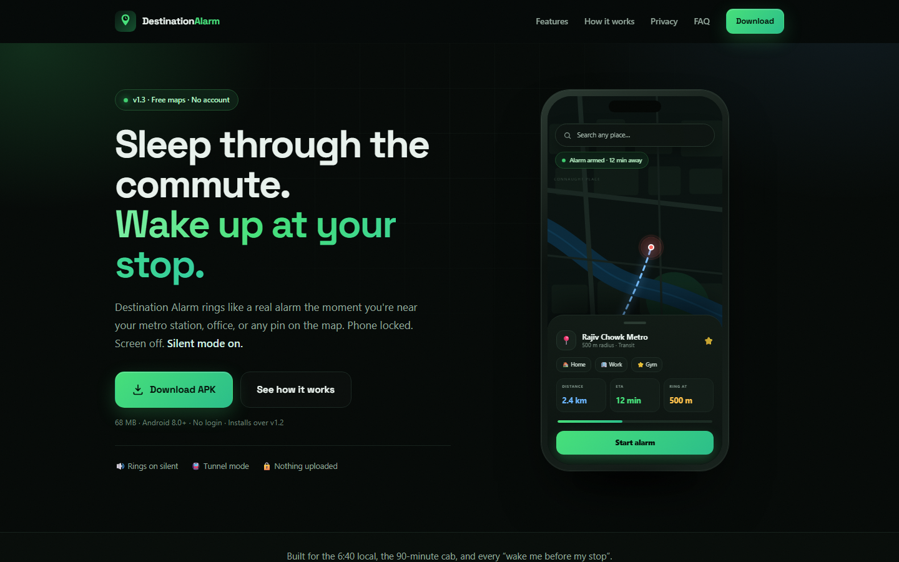
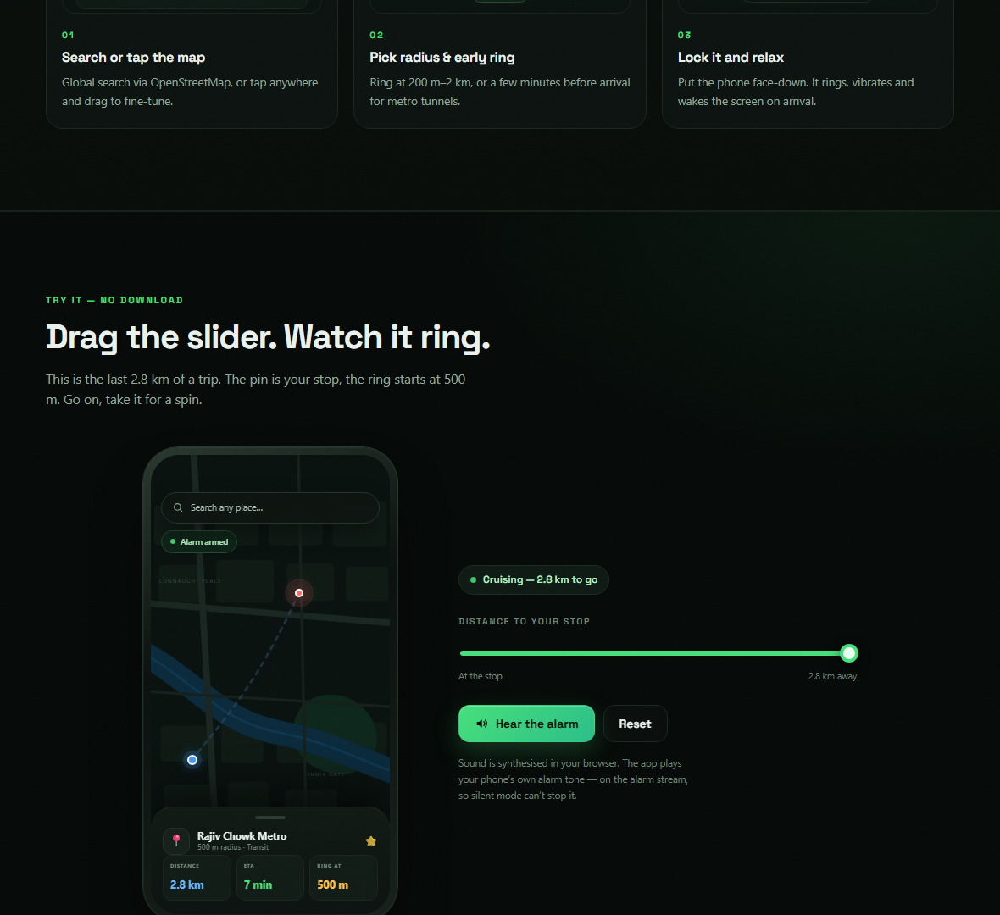
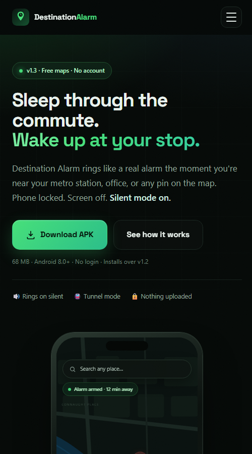

<div align="center">

# 📍 Destination Alarm

**Rings like a real alarm when you're about to reach your stop — even with the phone locked and on silent.**

[🌐 Live website](https://destination-alarm.netlify.app) · [⬇️ Download APK](../../releases/latest) · [🔒 Privacy policy](https://destination-alarm.netlify.app/privacy.html)



</div>

---

## Why

Falling asleep on the 6:40 local and waking up two stations past yours is a universal Indian
commute problem. Reminder notifications are too gentle, and they don't survive a locked screen
or silent mode. Destination Alarm uses Android's **alarm** path instead: set a pin, choose a
radius, lock the phone — it wakes you before the stop.

## Features

- **Rings on silent mode** — audio plays on the `STREAM_ALARM` stream, never media. Alarm volume
  is nudged to 90% while ringing and restored on dismiss.
- **Works with the screen locked** — a foreground location service keeps tracking; a full-screen
  alarm activity takes over the lock screen.
- **Ring before arrival** — optionally ring 1, 2, 3 or 5 minutes before the estimated arrival
  (drive / walk / transit estimate).
- **Tunnel mode** — when GPS dies underground, an ETA-seeded dead-man timer keeps counting and
  still rings before your station.
- **Pin-point picker** — search anywhere, then drag the map so the pin sits on the platform exit,
  not the middle of the road.
- **Saved places** — Home, Work, Gym or custom names; one tap to arm, long-press to delete.
- **Any radius** — 200 m to 2 km, plus the early-ring window.
- **No account, no tracking** — no sign-up, no analytics, no advertising ID, no server-side
  location history. Everything is stored on the phone and can be deleted in one tap.
- **Survives a reboot** — an active trip is restored after the phone restarts.
- **Free map stack** — MapLibre GL + OpenFreeMap tiles, Photon + Nominatim search, OSRM routing.
  No paid API keys.

## Screenshots

**Interactive demo on the website** — drag the distance slider and the phone starts ringing at
500 m:



<p align="center">
  
</p>

## How it works

1. Search a place or tap the map → drag to fine-tune the pin.
2. Pick a radius (or an early-ring window) and tap **Start alarm**.
3. Lock your phone. `AlarmService` keeps a foreground location fix and updates distance/ETA.
4. When you enter the radius — or the ETA timer fires underground — `AlarmActivity` wakes the
   screen and rings on the alarm stream with **Dismiss** / **Snooze 5 min**.

## Tech stack

| Layer | Tools |
|---|---|
| App | Kotlin 2.1, Jetpack Compose, MapLibre GL, Fused Location Provider, foreground service, full-screen intent |
| Maps & routing | [OpenFreeMap](https://openfreemap.org) (dark tiles), [Photon](https://photon.komoot.io), [Nominatim](https://nominatim.org), [OSRM](https://project-osrm.org) |
| Website | Hand-written HTML / CSS / JS — no build step, no framework |
| Hosting | Netlify (site) · GitHub Releases (APK) |

## Project structure

```
.
├─ android/              # Kotlin + Jetpack Compose app
│  ├─ app/src/main/…     # source, resources, manifest
│  └─ gradlew(.bat)      # Gradle wrapper (8.11.1)
├─ site/                 # landing page (index.html, styles.css, app.js, privacy.html)
├─ docs/screenshots/     # images used in this README
├─ prototype/            # early map prototypes (not used in the final app)
└─ MVP-SPEC.md           # original product spec
```

> The 68 MB APK is **not committed** — it lives in [Releases](../../releases/latest), so the repo
> stays small and every download is a single permanent URL.

## Build the Android app

Requirements: **JDK 17**, **Android SDK 35**, Gradle 8.11+ (wrapper included).

**Windows**
```bat
cd android
set JAVA_HOME=C:\path\to\jdk-17
set ANDROID_HOME=C:\path\to\Android\Sdk
gradlew.bat assembleDebug
```

**macOS / Linux**
```bash
cd android
export JAVA_HOME=/path/to/jdk-17
export ANDROID_HOME=/path/to/Android/Sdk
./gradlew assembleDebug
```

Output: `android/app/build/outputs/apk/debug/app-debug.apk`

The debug build is signed with a debug key, so it installs over previous builds. A release
keystore is not included in this repository (never commit one).

## Run the website locally

```bash
cd site
python -m http.server 8000
```

Open <http://localhost:8000>. Deployment steps (Netlify / GitHub Pages / custom domain) are in
[`site/DEPLOY.md`](site/DEPLOY.md).

## Download

Grab the latest APK from the [Releases page](../../releases/latest).

```
File:     DestinationAlarm.apk
Size:     67,676,096 bytes
Version:  1.3 (versionCode 4)
SHA-256:  9700e0aa474755b51241344a57f76ca5a1148178b2b72b2f2bb2ea9520798a4e
```

Android will ask you to allow **Install unknown apps** for your browser the first time.

## Privacy

No account, no analytics, no location history on a server, no advertising ID. The app stores your
trip and saved places locally; **Delete all data** in Settings wipes them.

Read the full [privacy policy](https://destination-alarm.netlify.app/privacy.html).

## Status & known limits

- **v1.3** — current build (saved places, settings, new icon, live trip stats).
- **Play Store**: not published yet (planned).
- **Transit ETA is an estimate** — OSRM has no transit profiles; tunnel mode covers GPS gaps.
- **Chinese OEMs** (Xiaomi / Oppo / vivo / realme) may need **Autostart** enabled manually.
- **iOS is not supported** — apps cannot bypass the silent switch the way Android's alarm stream can.
- The public Photon / Nominatim / OSRM instances are fine for a demo, not for large-scale traffic.

## Copyright

© 2026 Shivam. **All rights reserved.**

This repository is published for viewing and portfolio purposes only. You may **not** copy,
modify, redistribute, or use this code, the app's design, or its assets without written
permission. The **“Destination Alarm”** name and logo are not licensed for reuse.

See [LICENSE](LICENSE) for the full notice.

---

<p align="center">
  © 2026 Shivam · All rights reserved · Maps © OpenStreetMap contributors
</p>
